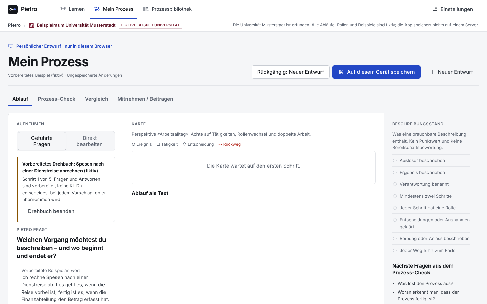

# Pietro

### Wissen teilen. Abläufe vereinfachen.

Turn everyday expertise into a process other people can understand, discuss and improve. Pietro helps teams describe their work, inspect handovers and compare useful patterns while preserving local responsibility.

**[Visit the demo](https://blackmath88.github.io/expertise-to-process/) · [Open the process lab](https://blackmath88.github.io/expertise-to-process/app/) · [Concept](CONCEPT.md) · [Run locally](#run-locally)**



*Recorded workbench at the start of a prepared example. Universität Musterstadt, its roles and its processes are fictional. Interface language: German, with Swiss spelling.*

> **Competition prototype · frozen.** Submitted as “Pietro – Wissen teilen, Abläufe vereinfachen” to the Universität Basel Ideenwettbewerb 2026. The deployed application is preserved. [Freeze record](AGENTS.md).

## Try one process

Open the [process lab](https://blackmath88.github.io/expertise-to-process/app/) and choose **Beispiel ausprobieren**.

1. Work through a prepared expense-claim example; accept, edit or reject each proposal.
2. Open **Prozess-Check** for facts, open questions and hypotheses tied to process steps.
3. Compare related examples in the **Prozessbibliothek**.
4. Use **Mitnehmen / Beitragen** to inspect and download a contribution for human review.

The prepared dialogue and process checks work without an API key. Downloading a contribution does not publish it or make it an institutional standard.

## From individual knowledge to shared understanding

| Phase | Organisational purpose | Current status |
|---|---|---|
| **Entdecken** | Learn a shared language and describe how work actually happens | Guided capture, exercises and process checks in the demo |
| **Teilen** | Compare examples and understand useful local differences | Static fictional library and contribution downloads |
| **Institutionalisieren** | Decide which improvements should become shared practice | Concept and pilot proposal; not an implemented governance system |

## What works today

- Guided or direct process editing, proposal previews and undo.
- A visual map with a text alternative and a completeness checklist.
- Deterministic, rule-based feedback; no invented savings or compliance verdicts.
- Library search and tag-based comparison.
- A redactable contribution preview, exported as JSON and Markdown for review.

Structured AI proposals, cross-team version merging and institution-wide integrations are future work. Optional live chat requires a separately configured proxy; it is off by default and does not edit process drafts.

## Run locally

Use **Node.js 22+**. The static app has no build step.

```bash
git clone https://github.com/blackmath88/expertise-to-process.git
cd expertise-to-process
npm start
```

Open **http://localhost:3000/app/**. To check library data and run unit tests:

```bash
npm run validate:library
npm test
```

Browser-test setup, the repository map and optional chat configuration are in the [technical guide](.github/TECHNICAL_GUIDE.md).

## Explore the project

| For | Read |
|---|---|
| Organisational purpose, research and pilot | [Concept, in German](CONCEPT.md) |
| Developers and technical reviewers | [Technical guide](.github/TECHNICAL_GUIDE.md) |
| Visual identity and component rules | [Design system](design-system/MASTER.md) |
| Corrections and contributions | [Contribution boundaries](CONTRIBUTING.md) |

Only fictional or explicitly publication-approved information belongs in this public prototype. Review status, demonstrated effectiveness and institutional authority are separate questions.

**Reuse:** no repository-wide code license is currently declared. Ask the owner before redistribution or reuse requiring a license.

Concept prototype by Achim Imboden. Universität Musterstadt is fictional.
