# Before / after

Same routes and state, viewport screenshots: desktop 1440 × 900, mobile 390 × 844. *Before* is `claude/website-journey` at `922942c`; *after* is this redesign.

<table>
<tr><th></th><th>Before</th><th>After</th></tr>
<tr><td>Landing hero</td><td>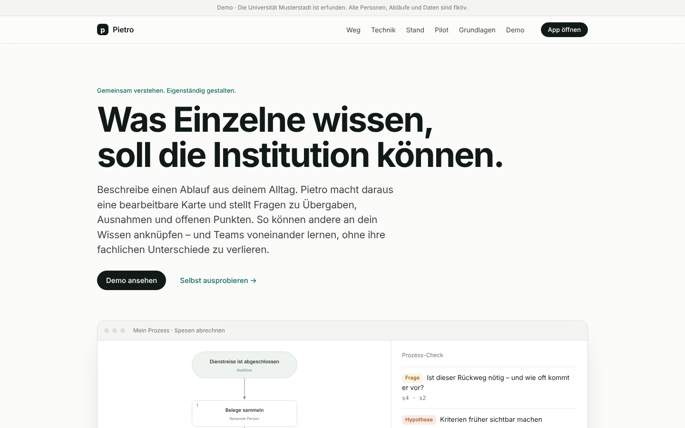</td><td>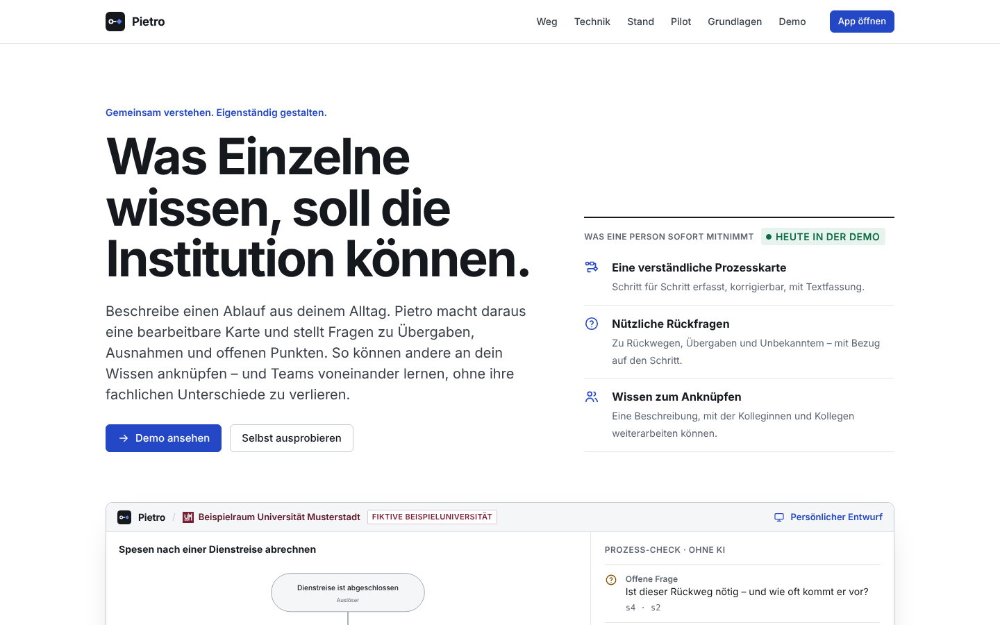</td></tr>
<tr><td>Demo · Universität</td><td>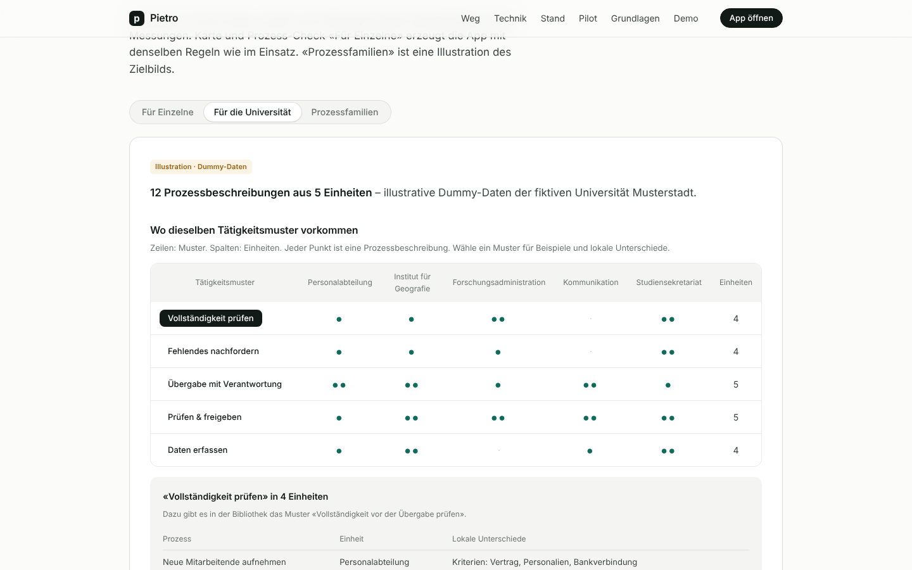</td><td>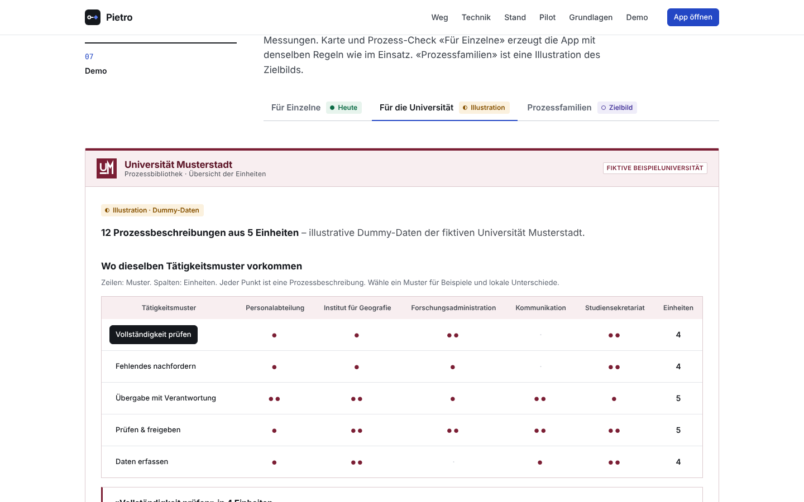</td></tr>
<tr><td>Demo · Für Einzelne</td><td>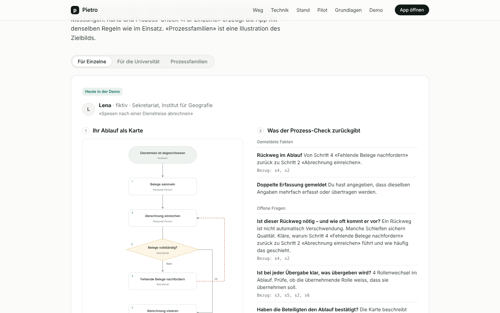</td><td>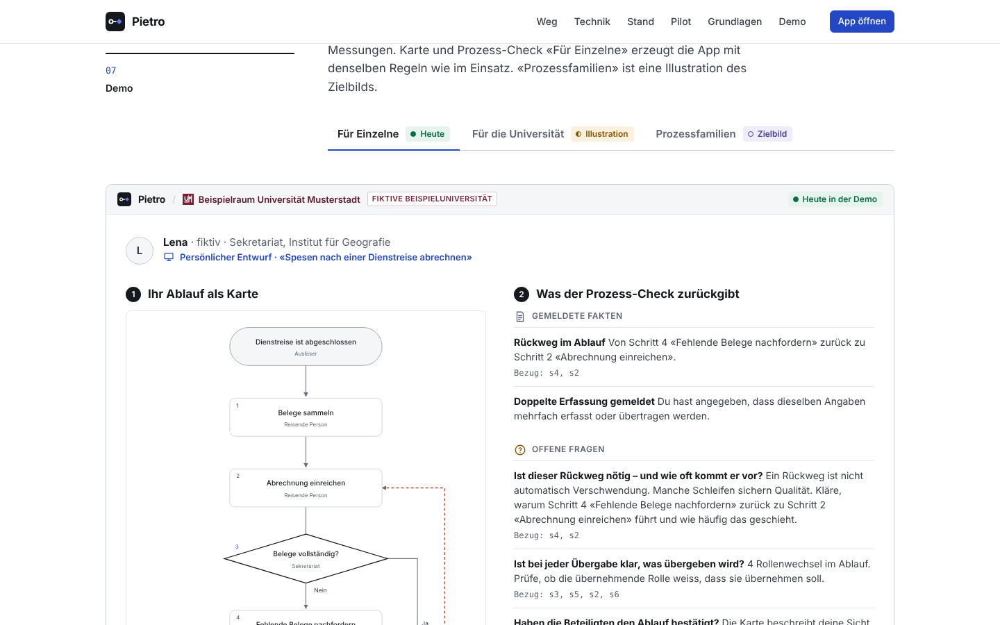</td></tr>
<tr><td>App start</td><td>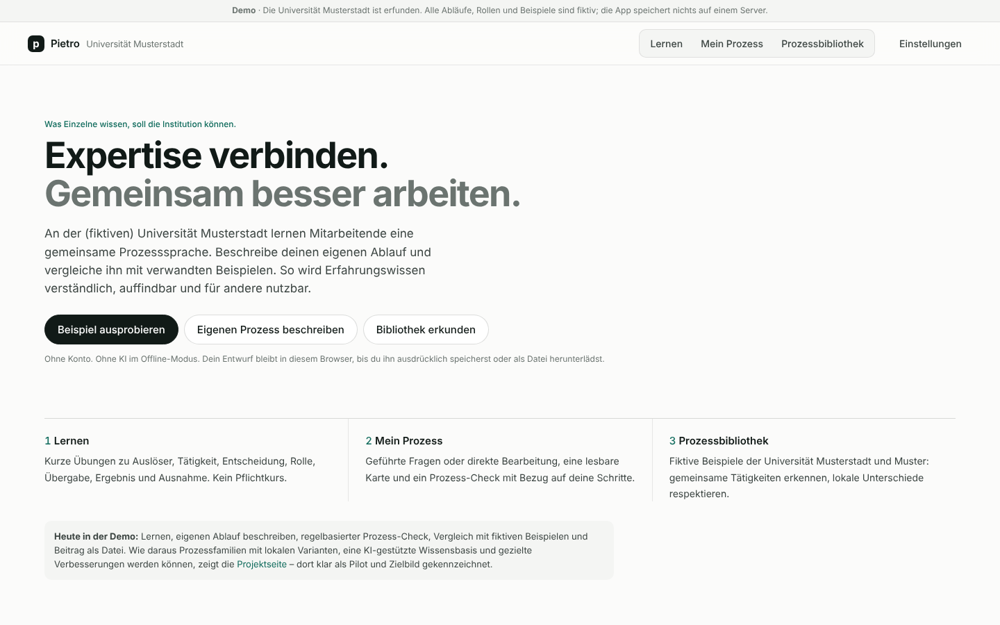</td><td>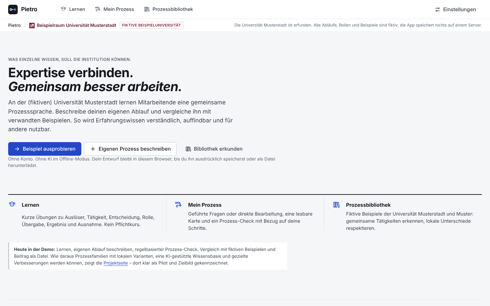</td></tr>
<tr><td>Workbench</td><td>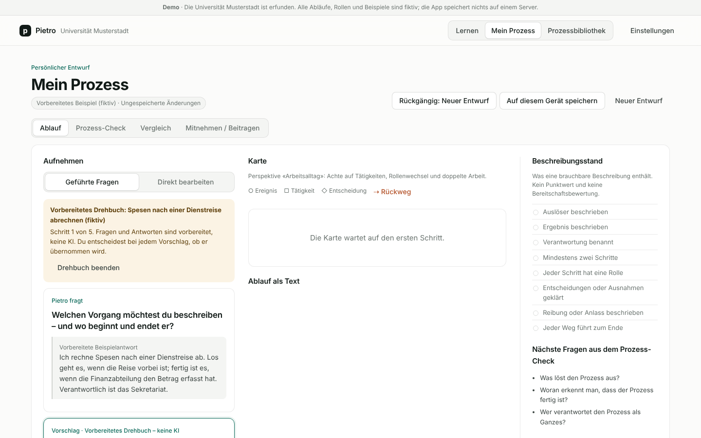</td><td></td></tr>
<tr><td>Library</td><td>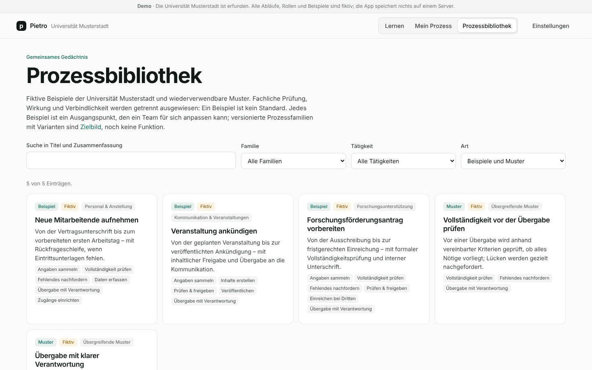</td><td>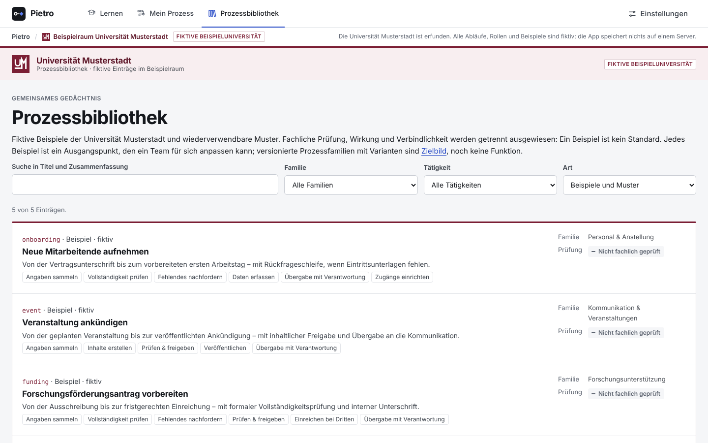</td></tr>
<tr><td>Library record</td><td>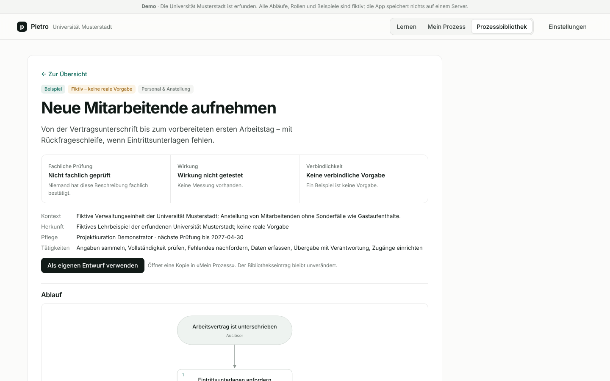</td><td>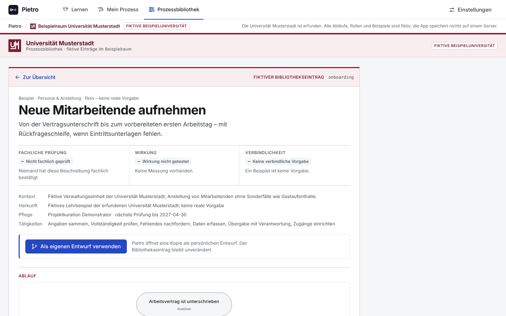</td></tr>
<tr><td>Mobile landing</td><td>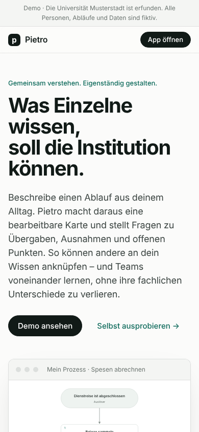</td><td></td></tr>
<tr><td>Mobile workbench</td><td>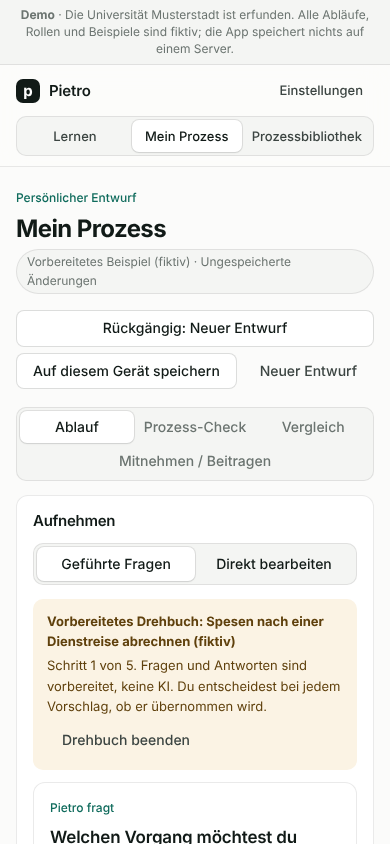</td><td>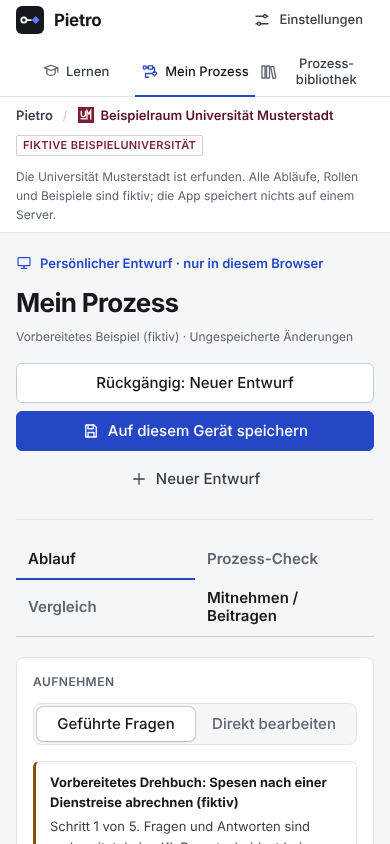</td></tr>
<tr><td>Mobile library</td><td>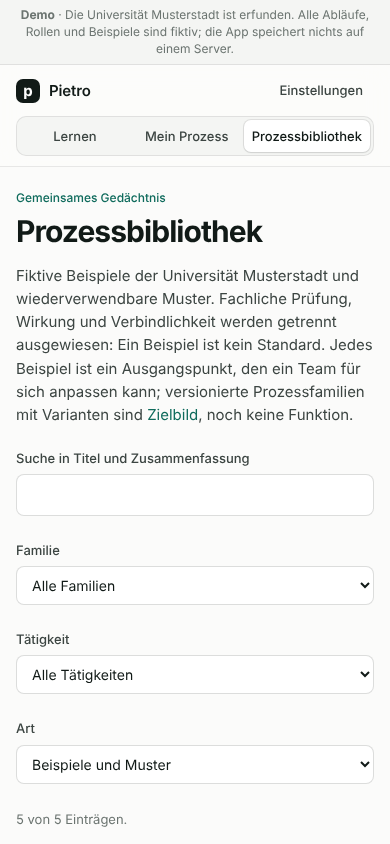</td><td>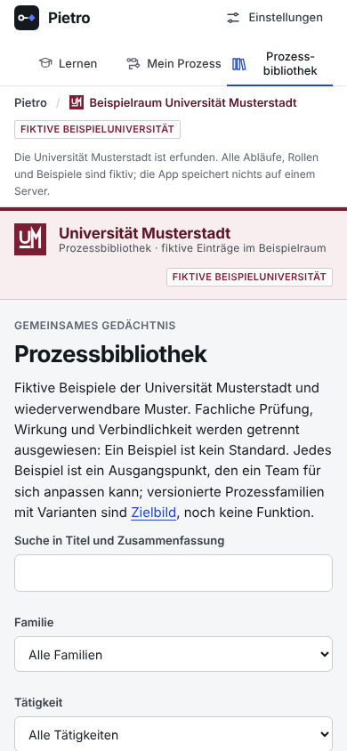</td></tr>
</table>
