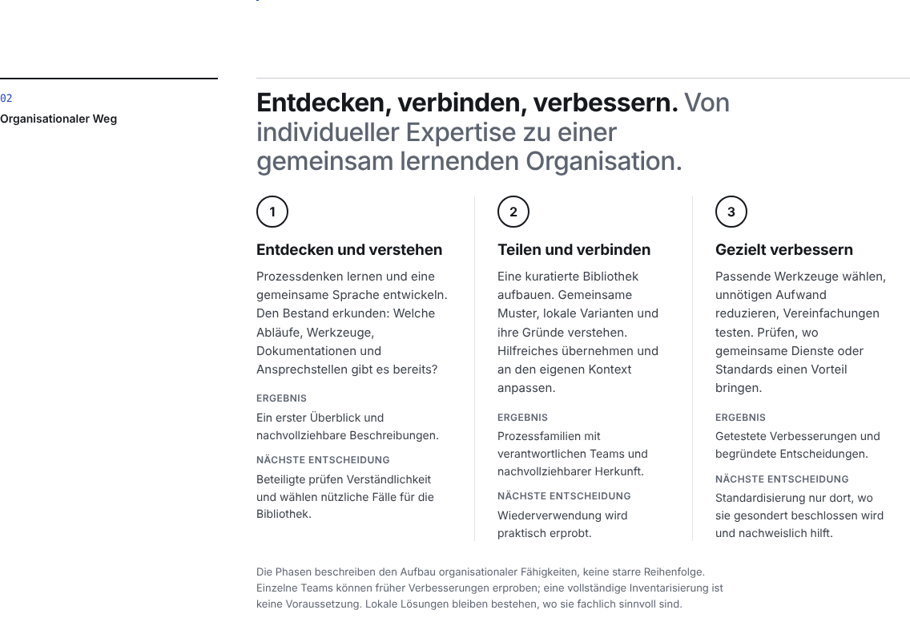
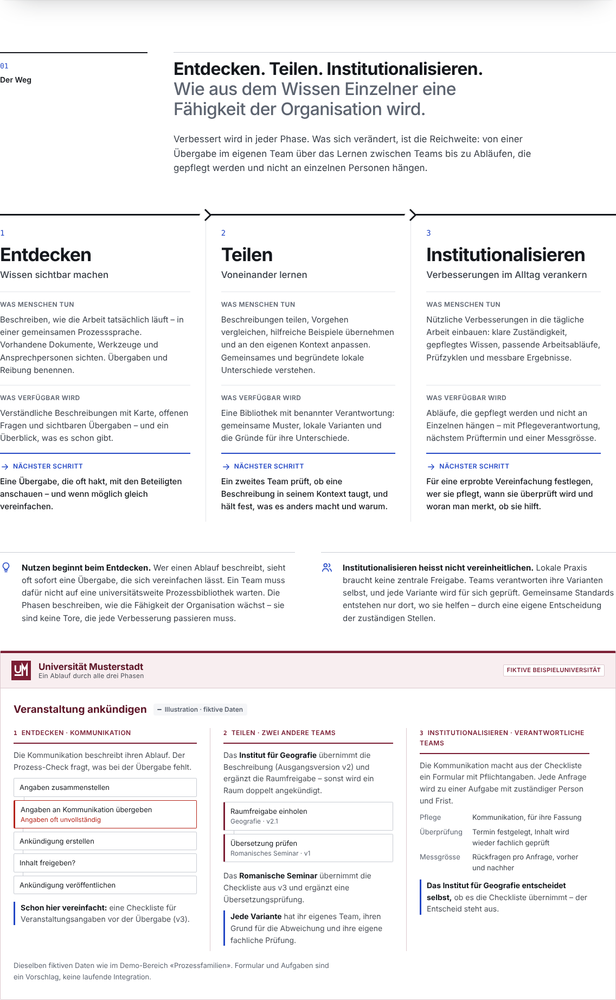
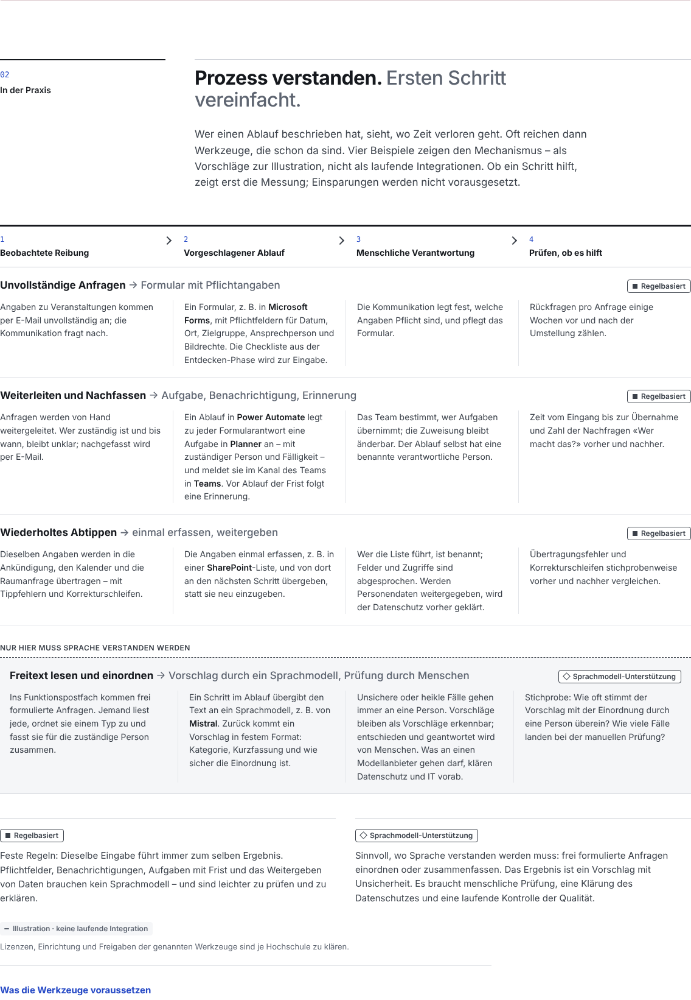
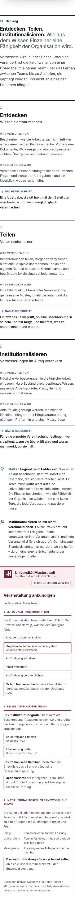
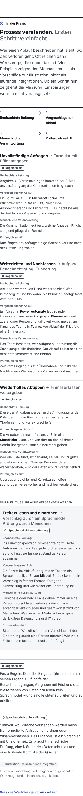

# Phases and practice sections

Section screenshots, Chromium 1194, sticky header disabled for capture.

| Before (main, `4434c8d`) | After |
|---|---|
|  |  |

## After · practical section, desktop

## After · mobile 390 px
| Phases | Practice |
|---|---|
|  |  |
